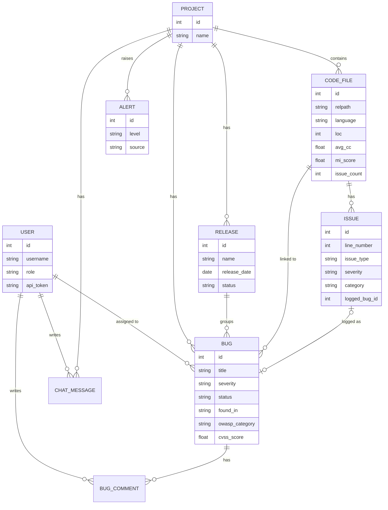

# SQMA - Project Documents (text for your report, PPT and demo video)

You make the final report, slides and video yourself; this file gives the content.

---------------------------------------------------------------------------------------------------
## A. PROJECT REPORT - chapter outline with content

### 1. Introduction
Software quality is hard to judge by feel. SQMA (Software Quality & Metrics Analysis Tool) is a web application that
measures quality from two sources - the **source code** (size, complexity, maintainability, security weaknesses) and the
**bug tracker** (defect density, escape rate, bug age, release readiness) - and turns the numbers into charts, statistics,
predictions, alerts and plain-English advice. It works offline; only the optional AI assistant needs the internet.

### 2. Objectives
1. Measure code size, complexity, maintainability and security for whole projects, sub-folders and single files.
2. Track bugs with severity, OWASP category, CVSS score, assignee and release; compute defect metrics.
3. Judge release readiness (Red / Yellow / Green) with transparent rules.
4. Apply statistical methods (descriptive statistics, control chart, box plot, correlation, t-tests, chi-square).
5. Predict defects and risk with a decision tree, a random forest and a Bayesian model.
6. Raise alerts automatically; give recommendations (rule-based and AI).
7. Offer a REST API, user roles and a safe, offline-capable tool.

### 3. Literature / standards used
* **Cyclomatic complexity** (McCabe, 1976): 1 + number of decision points; 1-5 low, 6-10 moderate, 11-20 high, 20+ very high.
* **Maintainability Index** (Oman & Hagemeister; Coleman): 171 - 5.2 ln(HV) - 0.23 CC - 16.2 ln(LOC), rescaled to 0-100. SQMA computes it per file from average function size and uses a documented Halstead-volume approximation (HV = avgFnLOC x log2 12). Bands calibrated by the project: 55+ / 40-54.9 / below 40.
* **CVSS v3** severity bands: None 0, Low 0.1-3.9, Medium 4.0-6.9, High 7.0-8.9, Critical 9.0-10.0.
* **OWASP Top 10** categories for classifying security bugs and issues.
* **GQM** (Goal-Question-Metric, Basili): goals -> questions -> metrics (Goals page).
* **Statistical process control** (Shewhart control chart, k-sigma limits), box plot / IQR rule, Pearson correlation, Welch's t-test, one-sample t-test, chi-square test of independence.
* Defect metrics: defect density (per KLOC), escape rate, MTTR, reopen rate.

### 4. Requirements
Functional: login with roles; projects; folder/file upload with junk skipping and limits; per-file and whole-project analysis for
Python, Java, JavaScript, C, C++; bug management (description, assignee, release, found-in, OWASP, CVSS); releases and readiness;
code-issue list with Log-as-bug; statistics and hypothesis tests; prediction models; alerts; report; REST API; AI assistant.
Non-functional: runs on Python 3.13, offline (except AI), safe uploads (path checks, CSRF, hashed passwords, escaped output),
friendly empty-states and error messages, no heavy dependencies.

### 5. Design
**Architecture (layers)**
```
Browser (Bootstrap, Chart.js, viz.js, ui.js, ai.js)
        |  HTTP / JSON
Flask app  --  blueprints: auth | bugs_views | files_views | ai_views | api
        |
Services:  file_service (upload, per-file cache, risk)   bug_service (validation)   alerts_engine
           analysis_service (aggregates analyze_file)      metrics_summary (shared numbers)
        |
Analysis engines:  analyzers/ (python ast, multi_lang, python_issues, security)   metrics/   stats_engine/
                   prediction/ (decision tree, random forest)   bayesian/   reports/
        |
SQLite (SQLAlchemy)  +  uploads/<project_id>/<relative path>        ai/provider.py -> Google Gemini (optional)
```
**ER diagram (Mermaid - paste into mermaid.live or a docs tool to draw it)**

**Module list:** auth, bugs_views, files_views, ai_views, api, config, file_service, bug_service, alerts_engine, analysis_service,
metrics_summary, analyzers (file_analyzer, code/complexity/structure/security analyzers, python_issues, multi_lang),
metrics (size, defect, release, maintainability, quality, cvss), stats_engine (descriptive, control_chart, boxplot, histogram,
correlation, hypothesis), prediction (decision_tree, defect_prediction, risk_prediction), bayesian, reports, ai (provider, context).

### 6. Implementation
* Python + Flask + Flask-SQLAlchemy (SQLite). Code analysis by `ast` for Python; tokenizer + regex + brace matching for the other languages.
* One entry point `analyze_file()` returns metrics, functions, issues for a file; the project result is the aggregation (so every page works for one file or all files).
* Upload: the browser filters junk and enforces limits first; the server re-checks (path sanitising, NUL-byte binary check, size, count).
* Security: CSRF token per session, hashed passwords, escaped templates, token-based API, API key kept server-side.
* AI: one provider class, a compact JSON summary of the project as system context, friendly handling of every failure.

### 7. Formulas with worked examples
| Metric | Formula | Example |
|---|---|---|
| Cyclomatic complexity | 1 + if + elif + for + while + case + catch + and/or + ?: | a function with 1 if, 1 for, 1 `&&` -> 1 + 3 = **4** |
| Defect density | bugs / KLOC | 12 bugs in 4,800 lines -> 12 / 4.8 = **2.5 per KLOC** |
| Escape rate | Production bugs / total bugs x 100 | 3 of 20 bugs found in Production -> **15 %** |
| Open : closed | open = Open + In Progress + Reopened | 8 open, 12 closed -> **8 : 12, 40 % open** |
| Average open-bug age | sum(now - created) / open bugs | ages 10, 20, 60 days -> **30 days**; 1 bug older than 30 days |
| Maintainability (file) | (171 - 5.2 ln HV - 0.23 CC - 16.2 ln avgFnLOC) x 100/171 | avgFnLOC 20, CC 4: HV = 71.7 -> (171 - 22.2 - 0.9 - 48.5) x 100/171 = **58.1 -> Highly maintainable** |
| Project MI | LOC-weighted mean of file MI | files (100 LOC, MI 60) and (300 LOC, MI 40) -> (6000 + 12000)/400 = **45 -> Moderate** |
| Control chart | CL = mean; UCL/LCL = mean +/- k sigma | counts 2,3,1,4,10: mean 4; sample s = 3.54; 3-sigma UCL = 14.6, LCL = max(0, -6.6) = 0; population sigma = 3.16 |
| Release readiness | RED: open Critical / 3+ open High / open security CVSS >= 9; YELLOW: open High / open > closed / open bug > 30 days | v1.1: 1 open Critical -> **Red** |
| Welch t-test | t = (m1 - m2) / sqrt(s1^2/n1 + s2^2/n2) | resolution times of severe vs minor bugs; p < 0.05 -> reject H0 |
| Chi-square | sum (O - E)^2 / E | module x severity table; p < 0.05 -> association |
| Defect probability | share of forest trees voting "defect" | 55 of 80 trees -> **68.8 % -> High** |

### 8. Testing
* Automated: `tests/smoke_test.py` (login/CSRF, bug rules, releases, alerts, API, every page with empty / bugs-only / code-only / syntax-error projects) and `tests/phase2_3_test.py` (folder with venv, node_modules, .git, binary, over-2 MB file, over-50-file batch, five languages, unsafe paths, Log-as-bug, per-file selector, API files, AI success and every AI failure mode). 216 checks, all passing.
* Manual test checklist: see section D below.

### 9. Results / screenshots to include
Login page; Dashboard (verdict, cards, release comparison, module table, riskiest files, folder chart); Upload page with a dropped folder and the
"Accepted ... skipped ..." summary; Files list with risk chips; File detail with highlighted source; Code Issues with Log-as-bug; Project Metrics
sub-folder chart; Bug edit page (OWASP, CVSS badge, assignee, release); Releases with Red/Yellow/Green; Control Chart with 2-sigma option;
Statistical Analysis hypothesis tests; Decision tree flowchart; Defect prediction (class counts, hold-out accuracy); Alerts with AI recommendations; AI Assistant chat; Report page.

### 10. Limitations
Regex-based analysis for Java/JS/C/C++; synthetic training data for the defect model; HV approximation in the maintainability index;
SQLite + dev server for small teams; AI answers can be wrong and need internet and a key; bug-to-file links must be added by the user (or via Log-as-bug).

### 11. Future work
Real parsers (tree-sitter) for more languages; import real defect history to train the model; Git integration (churn, authorship);
CI pipeline hook using the REST API; trend history of metrics over time; PDF export; PostgreSQL and a production server; more AI actions (auto-triage).

### 12. Conclusion
SQMA joins code metrics, bug metrics, statistics, prediction and alerts in one offline-capable tool that explains every number with its
formula, works per file or per project, and gives a clear "is this project in good shape?" answer.

---------------------------------------------------------------------------------------------------
## B. PowerPoint - 15 slides

1. **Title** - SQMA: Software Quality & Metrics Analysis Tool - name, course, date.
2. **Problem** - Quality is judged by feel; code and bug data live in different places; releases ship with hidden risk; need one explainable view.
3. **Objectives** - Measure code per file/folder/project; track bugs with CVSS/OWASP; release readiness; statistics + prediction; alerts; API; offline.
4. **Standards & concepts** - Cyclomatic complexity, Maintainability Index, CVSS, OWASP Top 10, GQM, control charts, hypothesis tests.
5. **Architecture** - Browser -> Flask blueprints -> services -> analysis engines -> SQLite + uploads (+ optional Gemini).
6. **Data model (ER)** - Project, Bug, Release, CodeFile, Issue, User, Alert (+ comments, chat); key links: Bug<->Release, Bug<->File, Issue->Bug.
7. **Upload & per-file analysis** - Folder / drag-drop upload; junk skipped (venv, node_modules, .git, binary, >2 MB); limits 100 MB / 50 files; `analyze_file()`; 5 languages.
8. **Dashboard** - Verdict line; quality, risk, maintainability; 10 riskiest files; sub-folder comparison; module risk table.
9. **Code issues & Log-as-bug** - Security + complexity + style rules; filters, export; one click creates a linked bug (no duplicates).
10. **Bug management & releases** - Description, assignee, OWASP, CVSS bands, found-in; escape rate per release; release comparison chart.
11. **Release readiness & alerts** - Red/Yellow/Green rules; aging, backlog, security and red-release alerts recomputed each time.
12. **Statistics** - Control chart (1/2/3 sigma, sample/population), box plot, histogram, correlation, Welch t-test, one-sample t-test, chi-square.
13. **Prediction models** - Decision tree flowchart; random forest defect probability (balanced synthetic data, hold-out accuracy); Bayesian risk.
14. **AI, API, security** - Gemini assistant with real project numbers, Ask AI on a bug, recommendations with rule-based fallback; REST API with tokens; CSRF, hashed passwords, safe paths.
15. **Results, limitations, future work, thanks** - 216 automated checks pass; limits (regex parsing, synthetic data); future (tree-sitter, Git churn, CI hook); Q&A.

---------------------------------------------------------------------------------------------------
## C. Demo video script (about 7 minutes)

| Time | Screen | Say |
|---|---|---|
| 0:00-0:30 | Login / Register | "SQMA measures software quality from code and from bugs. The first account becomes Admin; passwords are hashed and every form is CSRF-protected." Register. |
| 0:30-1:00 | Projects page, create project | "Create a project; everything below belongs to it." |
| 1:00-2:00 | Upload page: drag a project folder (containing venv/node_modules) | "I drop a whole folder. The browser skips junk before upload - see the summary: accepted N, skipped M, venv, node_modules, binary. Limits are 100 MB and 50 files. Sub-folders are kept." Click Upload & Analyse. |
| 2:00-2:45 | Files page, then a File detail page | "Every file has lines, functions, complexity, maintainability and a risk colour. In the detail page I see per-function complexity, the issues, and the source with highlighted lines." Click an issue to jump. |
| 2:45-3:15 | Code Issues | "Security, complexity and style issues. One click logs an issue as a bug; it becomes 'Logged as bug #12'. I can also log all High issues." |
| 3:15-4:15 | Bug Management: add a bug with OWASP + CVSS 9.8 + release + assignee; load demo bugs; open Releases | "CVSS shows a live badge. Found-in Production feeds the escape rate. Each release shows counts and a Red/Yellow/Green readiness with reasons." |
| 4:15-5:15 | Dashboard | "The verdict says the project condition and how many files are high risk. Open:closed, average age of open bugs, escape rate, release comparison, sortable module risk table, riskiest files and sub-folder comparison." Click a column header to sort. |
| 5:15-5:45 | Alerts | "Alerts are recomputed every time: aging bugs, growing backlog, critical security bugs, red release." |
| 5:45-6:30 | Statistical Analysis + Control Chart + a prediction page with file selector | "Hypothesis tests show H0, H1, statistic, p-value and a plain conclusion. Control chart lets me choose 2 or 3 sigma and sample or population variance. On any analysis page I can pick one file instead of the whole project." |
| 6:30-7:15 | AI Assistant, Ask AI on a bug, Report | "With a free Gemini key the assistant answers with my real numbers; Ask AI explains a bug; if AI is down the rule-based tips remain. The Report shows each formula with its working." Mention REST API and the 216 automated checks. |

---------------------------------------------------------------------------------------------------
## D. Manual test checklist
1. Register (first user = Admin); log out; wrong password shows a message; register a second user (Developer); Developer cannot add users.
2. Create project; every sidebar page opens with no code (shows "Upload your source code first" where relevant).
3. Load demo bugs; edit one bug (status Resolved sets resolved date; Reopened adds 1); add a bug with CVSS 11 -> rejected.
4. Releases: add, edit, delete (bugs kept). Dashboard release chart and readiness light visible.
5. Upload a folder with venv/node_modules/.git/binary/big file -> summary correct; >50 files -> friendly message; re-upload replaces same paths.
6. Files list sorts/searches; file detail shows source and highlights; Log as bug twice -> second time shows "Logged as bug #N".
7. Pick a single file on Size/Complexity/Quality/Statistics/Box Plot/Correlation/Decision Tree/Defect/Risk/Security/Maintainability; numbers change; "All files" restores.
8. Statistics: change variance type, target complexity; Control Chart: sigma 1/2/3; Report prints the options used.
9. API: curl examples from README (401 without token, 400 on bad data).
10. AI: without key -> setup steps; with key -> chat answer; Ask AI on a bug; Save as comment; disconnect internet -> friendly message.
